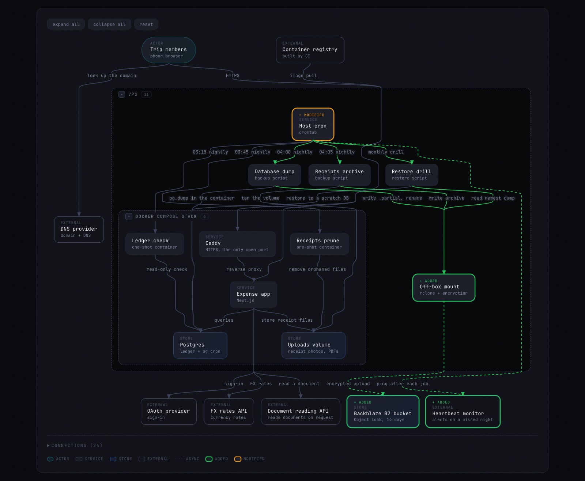
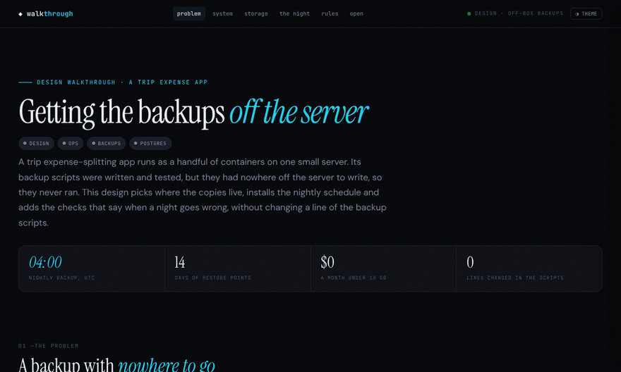

# claude-plugins


> Five Claude Code plugins that make Claude's work visible and verifiable: set a repo up, hear when Claude is done, pick up where you left off, see what a session did, and check it against what you asked for.

[](https://apurvbazari.github.io/claude-plugins/walkthrough/examples/backup-design.html)

*A page made by `walkthrough`: one self-contained HTML file. [Open the live example](https://apurvbazari.github.io/claude-plugins/walkthrough/examples/backup-design.html).*

## Install

**From Anthropic's plugin directory.** In claude.ai, open **Customize → Plugins**. In Claude Code, run `/plugin directory`. `onboard` and `notify` are listed there today; `handoff`, `walkthrough` and `lens` will follow.

**From this repository.** All five plugins, at the latest release:

```bash
claude plugin marketplace add ApurvBazari/claude-plugins
```

```bash
claude plugin install walkthrough@apurvbazari-plugins
```

Swap `walkthrough` for any plugin name below. Each plugin works on its own.

## Plugins and commands

| Plugin | What it does | Commands | Works in |
|---|---|---|---|
| **[onboard](./onboard/)** | Generates Claude tooling for a repo (`CLAUDE.md`, rules, skills, agents, hooks), then keeps it in step as the code changes. | `/onboard:start` · `/onboard:adopt` · `/onboard:check` · `/onboard:evolve` · `/onboard:update` · `/onboard:verify` | Claude Code |
| **[notify](./notify/)** | Desktop notifications on macOS and Linux when Claude finishes or needs you. | `/notify:setup` · `/notify:check` · `/notify:uninstall` | Claude Code |
| **[handoff](./handoff/)** | Saves where a session left off and offers it back when the next one starts. | `/handoff:save` · `/handoff:pickup` · `/handoff:check` · `/handoff:discard` | Claude Code |
| **[walkthrough](./walkthrough/)** | Turns a session, a plugin or a codebase into one interactive HTML page with diagrams and clickable detail. | `/walkthrough:create` · `/walkthrough:document` · `/walkthrough:update` | Claude Code, Cowork, claude.ai |
| **[lens](./lens/)** | Reviews a session's changes against the spec and plan they were meant to follow, then tries to disprove each finding before it shows it to you. | `/lens:review` | Claude Code |



## How they fit together

- **lens** judges and **walkthrough** draws: lens hands its review to walkthrough to render. Without walkthrough, lens writes a markdown report instead.
- **onboard** can offer walkthrough, notify and the language-server plugins for your stack while it sets up a repo. It installs only the ones you pick.
- **handoff** and **notify** stand alone.

## What they touch

None of the plugins has a server, an account or telemetry, and nothing is sent to the author. What they write stays in your project or your Claude settings folder. Every plugin README has a **What it reads, writes, and sends** section, and [PRIVACY.md](./PRIVACY.md) has the summary.

## Learn more

- [Docs site](https://apurvbazari.github.io/claude-plugins/): a page per plugin, with examples.
- Plugin READMEs: [onboard](./onboard/README.md), [notify](./notify/README.md), [handoff](./handoff/README.md), [walkthrough](./walkthrough/README.md), [lens](./lens/README.md).
- [Companion plugins and credits](./ACKNOWLEDGEMENTS.md): plugins that pair well with these, and the tools they rely on.
- [Contributing](./CONTRIBUTING.md): layout, branching, versioning and checks.

Built on [Claude Code](https://code.claude.com/docs/en) by Anthropic. These plugins are independent and not made or endorsed by Anthropic.

## License

[MIT](./LICENSE)
